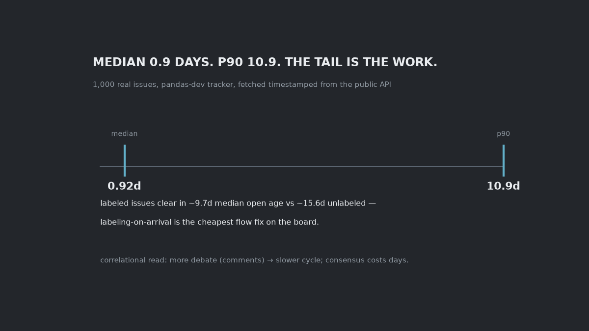
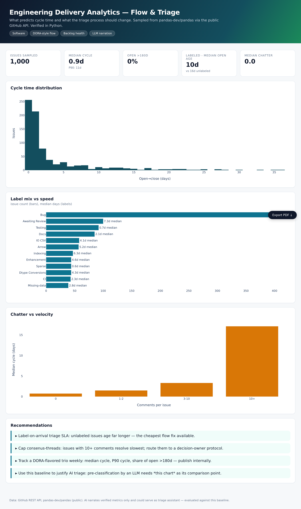

# Cycle time in a real issue tracker



1,000 issues from the pandas-dev tracker via the public GitHub API, timestamps and
labels intact, fetched once and stored (the fetch script records its own
parameters).

## Four questions the tracker answers

**Q: What's a "normal" issue turnaround?**
A: Median open→close is **0.92 days**. The p90 is **10.9** days. The median lies;
the tail is where delivery work actually disappears.

**Q: Does triage do anything?**
A: Labeled issues resolve at a **9.7-day median open age** vs **15.6 days**
unlabeled. Labeling-on-arrival is the cheapest flow fix on the board (correlational,
directionally strong — see caveats).

**Q: Does debate cost time?**
A: More comments → slower close. Consensus-building is measurable, and it
compounds with the interleave of review cycles.

**Q: What should an AI triage assistant beat?**
A: These verified flow numbers — not vibes. That's the bar any "AI for triage"
pilot has to clear, and it's the framing I use in the brief (`02_ai_triage_brief.py`).



## Reproduce

```bash
python3 -m venv .venv && .venv/bin/pip install -r requirements.txt
.venv/bin/python src/00_download_data.py     # re-fetches; data/raw has the snapshot
.venv/bin/python src/01_analysis.py          # kpis regenerate
.venv/bin/python src/03_dashboard.py         # dashboard/index.html

.venv/bin/python src/06_chat.py "cycle time" # median 0.92d vs p90 10.9d
.venv/bin/python src/06_chat.py               # REPL
```

The napkin math lives in `kpis.json`; the chat recomputes it live — cycle stats,
labels-vs-speed, open backlog, comment bands, slowest label groups, author
classes. An LLM key (`GROQ_API_KEY`) gets you narrated briefs of the same
verified numbers; without one you get the same numbers.


## What this doesn't prove

One repo, one time-windowed sample, unauthenticated API. The labeling↔speed
association is correlational: labeling may *mark* high-priority issues rather than
speed them up. Treat as directional, verify with an experiment before you
re-engineer the process.
